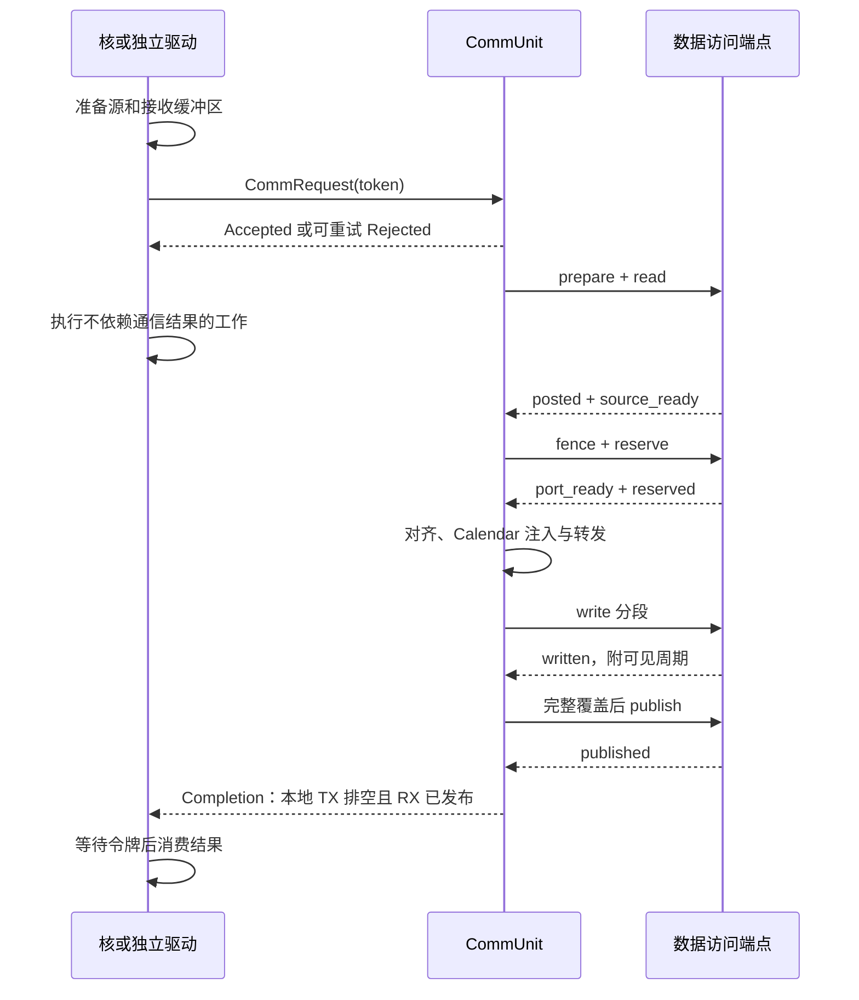

# 核与 WSE 的解耦接口

本次按 [ssnpu-model issue #2](https://github.com/hmljy2020/ssnpu-model/issues/2) 把通信拆成请求、数据访问、完成通知三个接口。`CommUnit`（通信单元）负责整片 WSE 的集合通信；核通过 `CommPort` 适配自身的指令和存储对象。独立字节驱动与真实核适配器使用同一组消息。

## 责任与配置

| 模块 | 持有的信息与职责 |
|---|---|
| 核 / `CommPort` | 核指令、数据绑定与代际、源数据寿命、目的存储预留；提交、重试、等待令牌和唤醒消费者 |
| `CommUnit` | 接纳、数据读取与接收登记、共同时间原点、Calendar 时隙、网络传输、写入覆盖、发布及完成/故障 |
| 数据访问端点 | 按授权范围读取和写入，执行本地端口服务，报告写入可见；真实核由 `TileReg` 承担 |
| 联合编译器 | 从同一计划生成核侧请求与 WSE 侧时隙配置，计算共同版本号 |

运行中的 `CommUnit` 不读取核指令、capture、Tile 描述或核流水线。构造参数只有 `installation` 和 `platform`。前者含 CalReg（Calendar 时隙配置）的行为级内容；后者含网络拓扑所用参数、时钟，以及端点声明的写服务和消息延迟。

现有 `wse-communication/1` 是联合编译器的输入。`frontend/communication.py` 负责它与 capture 的绑定，`models/noc/compiler.py` 负责路由与时隙生成。编译结果分别为：

- 核侧：`comm.submit` 和 `comm.wait`，请求携带 RouteBits（路由位图）、操作、参与域、源/目的绑定及几何信息，不携带时隙。
- WSE 侧：`wse-communit/1`，包含各域的操作、轮次、窗口、路由摘要、数据范围及接收覆盖，不包含核指令编号或 Tile 对象。

两侧共享 SHA-256 版本号；版本同时覆盖安装配置和平台参数。错误版本、平台变化、路由不匹配、错误轮次或参与集合都会被拒绝。整数节点键经过 JSON 规范化，配置保存再读取不会改变版本号。当前安装在实例创建时完成；切换配置需在外部确认收尾后创建新实例。

## 三个接口

消息定义在 `models/noc/protocol.py`，均为不可变 dataclass。

| 接口 | 消息与关键字段 |
|---|---|
| 请求 | `CommRequest(token, endpoint, node, operation, epoch, domain, members, version, route_bits, source, destination, destination_offset)` |
| 数据访问 | `DataCommand(token, kind, region, detail)` / `DataReply(token, event, detail)` |
| 接纳与完成 | `Accepted(token)`、`Rejected(token, reason, retryable)`、`Completion(token, status, error, safe_to_release)` |

`DataRange(handle, offset, nbytes, capacity)` 描述一段授权范围。`handle` 是数据所有者发出的不透明绑定，必须区分代际。通信单元只检查范围和合同一致性；真实核适配器把它映射到已有 Tile 版本，独立驱动把它映射到字节数组。端点验证每个数据命令的绑定、代际和范围。

数据命令依次包括 `prepare`、`read`、`fence`、`reserve`、`write`、`publish`：登记预期接收段、读取源包、取得端口可用时间、预约写服务、写入分段、发布完整目标。对应回复为 `posted`、`source_ready`、`port_ready`、`reserved`、`written`、`published`；数据错误统一回复 `fault`。

`write` 的明细为 `(source_node, destination_offset, nbytes, payload)`。独立驱动携带真实 bytes；性能核模型的 payload 为 `None`，只模拟字节范围、端口和时序。FA 的核指令来自 PTO capture，通信计划绑定其中的指令和 Tile 版本。

## 接纳、寿命与完成



`comm.submit` 在收到 `Accepted` 时完成，核可继续独立计算。源读引用保留到读取结束，不能随提交完成释放。`comm.wait` 可以先进入等待，也可以晚于完成通知才执行；适配器保存完成令牌直到等待者取走。目标版本的生产者是 `comm.wait`，因此依赖该版本的计算会等到成功完成后才发射。

TX 表示发送端，RX 表示接收端。成功条件是该请求的本地 TX 已排空，且本地 RX 的所有授权分段已写入并发布。不同节点的成功通知可以在不同周期发生。`drained()` 表示通信单元整体已收尾，另外检查事件和内部消息队列；调用方仍须清空自己的消息传递队列。成功令牌与全局 drain 是不同状态。

本版同时接纳一个集合域，按该域全部成员的需求预留整包 TX/RX 容量，因此不会因等待未接纳的同组成员而形成队列深度死锁。其他域收到可重试背压；真实核适配器收到拒绝后等一周期重新发出请求。它仍持有该请求所需的本地存储。实际硬件缓冲深度尚无标定值，报告记录静态预约容量，不把它伪装成已知容量限制。

同一 token 或同一域/成员不得重复接纳；轮次由安装合同约束。接收覆盖按来源去重，目标发布要求全部分段可见。链路冲突、超窗、未授权写和提前发布等在途错误使通信单元进入故障状态，向尚未完成的请求返回 `safe_to_release=False`，保留其绑定并停止推进。真实核将该故障上报为 `ModelError`，不会继续执行消费者；恢复与重新安装由后续方案定义。

## 时间接口

`platform.write_service` 声明 Shared 写带宽和结果延迟。核适配器还声明：

- `endpoint_command_cycles=1`：网络数据交给 `CommPort` 后，再过一个核周期到达存储端口。
- `reservation_roundtrip_cycles=4`：预约从通信单元经适配器到存储端口，再经适配器回复的往返界限。

接收包先完成网络与跨时钟域服务，再经过端点消息延迟，才能开始预约写入。自动窗口覆盖端点延迟、写服务、结果可见延迟和余量。预约确认迟于共同时间原点会明确失败。更换端点实现时，应提供相符的延迟合同，并重新联合编译。

## 独立运行与覆盖范围

```bash
PYTHONDONTWRITEBYTECODE=1 PYTHONPATH=. python3.11 -S \
  examples/communication/driver.py --output workspace/communit-driver/report.json
```

该驱动不创建核、指令或 capture。默认节点为 0、1、9，每节点每轮贡献 64 B，连续两轮；首轮在周期 0、11、22 提交，第二轮在周期 8 提交并触发背压。客户端收到接纳后做七周期独立工作，再等待令牌。接收内容必须与按参与节点排序拼接的源字节完全一致。

当前通信只提供 AllGather/复制。FA 的最大值、指数重标定和求和均在核内执行。自动计划仍按整包、逐树保守分配窗口；该接口解耦不会自动带来更好的网络并行调度。
