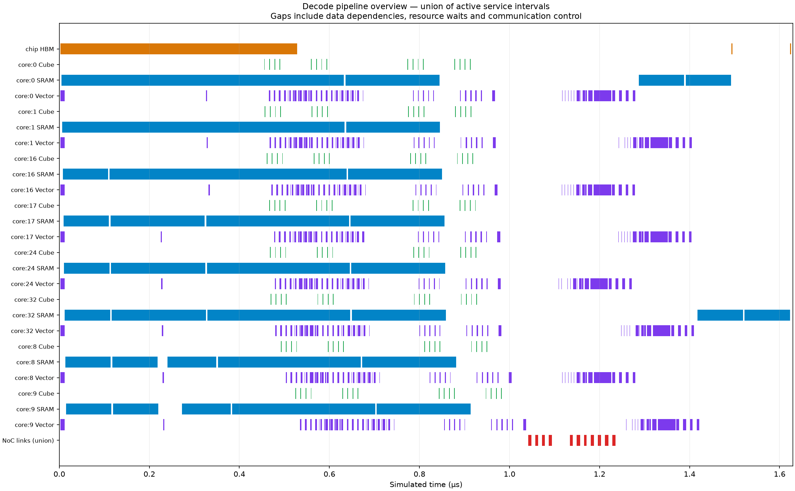

# CommUnit 接口与 decode FA 复跑

2026-11-13，在本地 macOS、Python 3.11.15 上运行。数值验证使用 NumPy 2.4.6，绘图使用 Matplotlib 3.11.2，`OPENBLAS_NUM_THREADS=1`。本次按 [issue #2](https://github.com/hmljy2020/ssnpu-model/issues/2) 更换通信接口，保留此前 decode 的 Q/K/V 输入、HBM 带宽服务、计算预算和分片方式。FA 为 FlashAttention；本例每次只计算一个 query token，不包含前后投影。

**101 项测试全部通过；两组 decode 均通过单核和独立稠密参考检查。** [测试日志](validation/communit/tests.txt)、[机器可读比较](validation/communit/comparison.json)及[独立驱动结果](validation/communit/standalone.json)随代码保存。

## 相同输入下的前后比较

两组均使用 batch=1、每核 4 个 PE（处理单元）、核频率 1.4 GHz、NoC（片上网络）频率 2 GHz。HBM（高带宽存储器）为全片共享 256 GB/s，启动延迟为零；本核 SRAM 读写共享 1 TB/s、每次 100 ns 启动开销。Cube 为整核 4096 MAC/周期（一次乘加计一个 MAC），Vector/转换为整核 256 B/周期，均按 PE 数固定等分。

Q/K/V 为 FP16；矩阵累加和在线 softmax 状态为 FP32，PV 前概率转换为 FP16。Q/K/V 按 seed=7、均值 0、标准差 0.5 的正态分布生成。本次直接读取上次保存的 `inputs.npz`，逐数组验证相等，输入文件 SHA-256 也相同。

| 条件/结果 | 8 核用例 | 40 核用例 |
|---|---:|---:|
| Q heads / KV heads | 8 / 2 | 32 / 8 |
| head_dim / KV 序列长度 | 32 / 512 | 128 / 1280 |
| 每个 KV head 的分片核数 | 4 | 5 |
| 计算块 / HBM 搬运块，token | 64 / 128 | 128 / 256 |
| 重构前总核周期 | 2239 | 33882 |
| 重构后总核周期 | 2281 | 33919 |
| 重构前 → 后，多核时间 | 1.599286 → 1.629286 µs | 24.201429 → 24.227857 µs |
| 单核时间，前后相同 | 6.381429 µs | 67.920000 µs |
| HBM 总流量，前后相同 | 134144 B | 5300224 B |
| 多核对单核，最大绝对误差 | 1.2357952e-5 | 1.2315344e-5 |
| 多核对 FP64 稠密参考，最大绝对误差 | 1.5280276e-5 | 1.2733850e-5 |
| 单核对 FP64 稠密参考，最大绝对误差 | 1.7155960e-5 | 1.0365487e-5 |

所有元素满足 `abs(actual-reference) <= 5e-4 + 5e-3*abs(reference)`。三种输出——多核、单核、稠密参考——与接口重构前保存的相应数组逐项完全相等。两个“单核”均把全部 batch/head 任务串行放在 Core 0 上，保留同一核内的四个 PE、数据类型、计算块和 HBM 带宽。

这里的重构前基线是上次在本工作区实现的 decode 版本，不是尚无 decode 示例的 `origin/main`。本次时间增加分别为 42 和 37 个核周期：请求/数据接口多经过核侧适配器，写端口预约和自动窗口也计入了这段延迟。数值计算与 HBM 流量保持一致。总时间包含计算、访存、集合通信、结果合并、输出写回、退休及消息收尾，是未做硬件校准的模型结果。

本次重复使用旧输入的完整命令：

```bash
PYTHONDONTWRITEBYTECODE=1 PYTHONPATH=. OPENBLAS_NUM_THREADS=1 \
MPLCONFIGDIR=workspace/matplotlib workspace/decode-venv/bin/python examples/decode/run.py \
  --inputs workspace/decode-demo/inputs.npz \
  --output-dir workspace/communit-decode-demo

PYTHONDONTWRITEBYTECODE=1 PYTHONPATH=. OPENBLAS_NUM_THREADS=1 \
MPLCONFIGDIR=workspace/matplotlib workspace/decode-venv/bin/python examples/decode/run.py \
  --inputs workspace/decode-wse40/inputs.npz \
  --query-heads 32 --kv-heads 8 --head-dim 128 \
  --sequence-length 1280 --sequence-splits 5 --tile-tokens 128 --hbm-chunk-tokens 256 \
  --hbm-gbps 256 --output-dir workspace/communit-decode-wse40
```

新克隆仓库可省去 `--inputs`，使用同版本 NumPy 和默认 seed=7 生成输入；[示例说明](../examples/decode/README.md)列出依赖安装命令。生成结果保存在 `workspace/`。每份结果还导出分离的 `communication/requests.json`、`installation.json` 和 `platform.json`，并验证保存后的 WSE 配置可重新装入通信单元。

## 独立接口与回归条件

独立驱动使用节点 0、1、9，每节点每轮发送 64 B，连续两轮。首轮按周期 0、11、22 提交；第二轮在周期 8 提交，等第一轮释放准入后重试。字节模式为 `(epoch*19+node+offset) % 256`。客户端在接纳后执行七周期独立工作再等待令牌，全部目标须与源字节按节点顺序拼接的结果完全一致。本次 162 个驱动周期后清空消息并收尾成功。

11 项新增接口测试覆盖上述独立驱动、不同节点分别完成、JSON 往返及配置版本、错误请求拒绝、背压不接管请求、故障保留绑定、陈旧代际拒绝、先完成后等待，以及真实核上的源寿命和独立计算。真实核用两节点各 256 B 的相同基础负载，检查源存储晚于读取完成释放、独立计算在请求接纳与令牌完成之间执行。

其余测试保留原模型、NoC 与自动规划覆盖，并包括此前新增的 14 项 decode/整核预算测试。decode 数值测试固定输入和精度，改变随机种子或分片数时分别控制其他条件；覆盖非整除尾块、空分片、单 token、大分数以及超过 40 核后的分批复用。负向对照破坏一个实际发送状态，数值验证按预期失败。带宽对照只修改 HBM 带宽，检查流量保持相同而服务时间增长。

```bash
PYTHONDONTWRITEBYTECODE=1 PYTHONPATH=. OPENBLAS_NUM_THREADS=1 \
workspace/decode-venv/bin/python -m unittest discover -s tests -v

PYTHONDONTWRITEBYTECODE=1 PYTHONPATH=. python3.11 -S examples/communication/driver.py

PYTHONDONTWRITEBYTECODE=1 PYTHONPATH=. python3.11 -S tests/replay_captures.py \
  examples/matmul/capture examples/fa/capture examples/ooo/capture \
  --output-dir workspace/communit-replay
```

三份归档 capture 使用原 `default_config()`、不启用通信计划，独立重放审计通过；matmul、原 FA、ooo 分别为 7041、2182、22 核周期，与原回归记录一致。[重放摘要](validation/communit/legacy-replay.json)记录依赖、发射额度、资源互斥、退休和存储寿命检查。

## 计算与通信流水图

图中横轴是模型时间；条带取实际资源服务区间。橙色为 HBM，蓝色为本核 SRAM，绿色为 Cube 矩阵计算，紫色为 Vector，红色为 NoC 链路。概览将同核各 PE 的同类服务区间取并集，将全部网络链路取并集，不应把这些条带相加作为工作量或利用率。



[8 核详细流水图](validation/communit/decode-demo-detail.png) · [40 核概览](validation/communit/decode-wse40-overview.png) · [40 核详细流水图](validation/communit/decode-wse40-detail.png)

两组完整输出目录还包含 `pipeline.pftrace` 的指令生命周期，以及 `resources.trace.json` 的实际资源服务轨道，可用 Perfetto 查看。详细日志体积较大，保留在本地 `workspace/`，仓库归档摘要、测试证据和静态图。

接口当前支持 AllGather/复制，归约在核内执行；一次接纳一个集合域，自动窗口按整包逐树分配。HBM 为全片 FIFO 带宽模型。结果解释以这些条件为限，进一步提高通信并行度需要另行修改调度策略。
