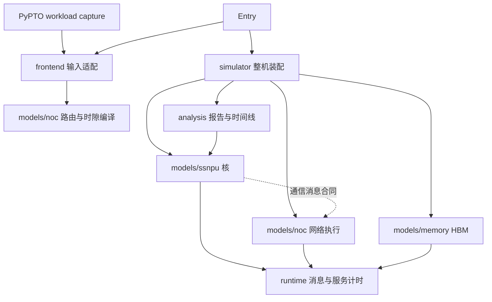

# 项目结构与依赖边界

功能目录和入口文件直接位于仓库根目录。硬件模型、输入适配、算子负载和结果分析分别存放，不再套一层同名 Python 包；原来的 `ssnpu_model` 目录也已移除。

这次调整保留时序公式、消息交付规则、硬件参数和报告字段。文件迁移不增加新的抽象基类、插件注册或多套执行框架。

## 目录

```text
wse-perf-sim/
├── pyproject.toml                 安装信息、可选依赖、命令入口
├── README.md                      使用入口
├── DESIGN.md                      核内消息、生命周期和时序设计
├── api.py                     simulate 公共接口
├── simulator.py               装配整机、推进周期、诊断停滞
├── cli.py        命令行入口
├── config.py                  配置默认值与校验
├── records.py / tiles.py       指令、版本、Tile 大小等共享定义
├── errors.py                  统一异常
├── models/
│   ├── ssnpu/                 超标量 NPU 核模型
│   │   ├── scheduler.py       依赖、分配与发射
│   │   ├── rob.py             重排序缓冲区准入与按序退休
│   │   ├── tile.py            Local/SharedTileReg 容量、版本与端口
│   │   ├── cube.py / vector.py 矩阵和向量执行单元
│   │   ├── execution.py       执行单元的操作数、计算和写回流程
│   │   ├── tlsu.py            核内 SRAM 访问与内存搬运
│   │   ├── comm.py            核侧通信适配 CommPort
│   │   └── sync.py            barrier 与 task 同步
│   ├── noc/                   Calendar 片上网络
│   │   ├── unit.py            CommUnit 网络执行与数据发布
│   │   ├── routing.py         路由树、位图与链路遍历
│   │   ├── compiler.py        路由与时隙编译、安装配置
│   │   └── protocol.py        请求、数据访问、完成通知合同
│   └── memory/
│       └── hbm.py             全片 HBM 带宽服务
├── runtime/
│   ├── component.py           组件队列和观察记录
│   ├── clock.py               消息交付与外部网络事件接入
│   ├── protocol.py            核内及存储消息、消息信封与目的命名
│   └── service.py             资源占用时间与结果延迟
├── frontend/
│   ├── capture.py             capture 解析、映射和校验
│   └── communication.py       显式通信计划与 Tile 版本绑定
├── analysis/
│   ├── report.py              只读汇总仿真状态和事件
│   ├── perfetto.py            原生 Perfetto / JSON 时间线导出
│   └── pipeline.py            资源时间线与当前 Decode 泳道图
├── benchmarks/                   外部 SSM 对比与参数校准工具
├── config/                       JSON 参数配置
├── examples/                     可运行示例和归档 capture、历史结果
├── tests/                        单元测试、回放审计和依赖边界检查
├── docs/                         设计、接口、验证及 benchmark 记录
└── workspace/                    新生成的报告、图片和临时文件，Git 忽略
```

## 关键边界

`models/ssnpu` 模拟一个核内部的硬件行为。ROB（Reorder Buffer，重排序缓冲区）决定哪些指令进入窗口及何时退休；Scheduler 决定何时分配、发射；TileReg 管理 Tile 数据的版本、容量和端口；Cube、Vector 和 TLSU（Tile Load/Store Unit，Tile 加载存储单元）消耗相应资源。`comm.py` 留在核模型，因为它负责将核指令和 Tile 生命周期转换成通信请求。

`models/noc` 与核模型平级。`CommUnit` 的输入是通信请求、平台参数和 Calendar 安装配置，独立字节驱动也能使用它。它只通过 `protocol.py` 的消息合同请求端点读写。核侧 SharedTileReg（共享 Tile 寄存器）仍是 NoC 端点；SRAM 仍由核内 TLSU 和存储服务处理。

`models/memory/hbm.py` 提供全片共享的 HBM（High Bandwidth Memory，高带宽内存）服务。SRAM 当前的头开销加数据量/带宽算法已经在 TLSU 内，没有为了目录对称另造一个 SRAM 包。

`runtime` 放时钟、消息队列和服务计时。它服务于多个硬件模型，不导入具体模型。`runtime/protocol.py` 是当前 WSE 模型内部的消息合同，包含核目的命名；`models/noc/protocol.py` 是独立通信单元的对外合同，两者职责不同。

`frontend` 负责把外部数据变成仿真输入。`capture.py` 解析 PyPTO capture；`communication.py` 将显式通信计划绑定到 capture 中的 Tile 版本，插入 `comm.submit` 和 `comm.wait`，再调用 NoC 编译器生成路由和时隙。NoC 模型不反向读取 capture。

`analysis` 读取仿真结果。`report.py` 需要识别组件以汇总统计，因此允许它依赖模型；硬件模型不依赖分析层。`perfetto.py` 将打点转换为时间线格式，`pipeline.py` 绘制资源占用图，Matplotlib 只在实际绘图时导入。

`simulator.py` 是整机装配入口，可以同时引用输入记录、核、NoC、HBM、时钟和报告。保留 `Simulator.run()` 返回报告的现有行为，报告的具体实现放在 `analysis`。这样无需为本次目录调整修改已有的调用协议。



图中虚线表示核侧 `CommPort` 只引用 NoC 消息类型，不持有或调用 `CommUnit` 实例。各组件仍由时钟交付消息。

## 旧路径迁移

下表旧路径均相对于原 `ssnpu_model/`，新路径相对于仓库根目录。

| 旧路径 | 新路径 |
|---|---|
| `components/` 中的核组件 | `models/ssnpu/` |
| `components/hbm.py` | `models/memory/hbm.py` |
| `components/base.py` | `runtime/component.py` |
| `components/service.py`、`components/protocol.py` | `runtime/service.py`、`runtime/protocol.py` |
| `clock.py` | `runtime/clock.py` |
| `communication/` | `models/noc/` |
| `trace.py` | `frontend/capture.py` |
| `noc_plan.py` | `frontend/communication.py` |
| `report.py`、`perfetto.py` | `analysis/report.py`、`analysis/perfetto.py` |
| `decode_plot.py` | `analysis/pipeline.py` |
| `api.py`、`simulator.py`、`config.py` 等顶层模块 | 仓库根目录下的同名模块 |

仓库根目录的 `ssm_baseline.py` 和 `calibrate_ssm.py` 移到 `benchmarks/`，从根目录用 `PYTHONPATH=. python3 benchmarks/ssm_baseline.py ...` 或 `python3 -m benchmarks.ssm_baseline ...` 运行。外部 SSM 工具链和 PyPTO 的准备条件沿用 benchmark 文档。

公共入口统一为 `from api import simulate` 和 `python -m cli`。原 `ssnpu_model` 导入和命令需迁移到下列入口，内部模块按上表更新。使用示例：

```python
from api import simulate, wse_config
from frontend.capture import TraceAdapter
from frontend.communication import allgather_group
from simulator import Simulator
from analysis.perfetto import to_pftrace
```

## 新功能放在哪里

- 改时序、资源竞争、端口和生命周期，放到对应 `models` 模块。
- 支持新的 capture 格式或通信绑定，放到 `frontend`。
- 新算子的分块和任务映射在 PTO 侧定义，回放示例放到 `examples`。
- 增加报告字段、图表或导出格式，放到 `analysis`。
- 比较外部模型、实测数据或拟合参数，放到 `benchmarks`。

`tests/test_architecture.py` 检查模型和运行基础设施的依赖边界，以及独立 NoC 导入和基础 API 的可选依赖隔离。历史验证见 [目录重构验证](STRUCTURE_VALIDATION.md)。
